<a href="https://github.com/pankaj0621">
  
</a>

  
  
  




<a href="https://github.com/pankaj0621/finsight"></a>

  
  

The preview is up; its backend displayed offline when checked.

<a href="https://github.com/pankaj0621/vibe-1-stackfinity"></a>

  
  

The live preview opens at the sign-in screen.

<a href="https://github.com/pankaj0621/caresync"></a>

  
  

The live preview opens at the sign-in screen.

<a href="https://github.com/pankaj0621/langgraph-college-helpdesk"></a>

  




  



  
  
  

